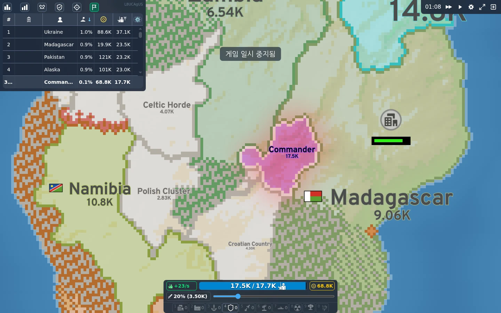
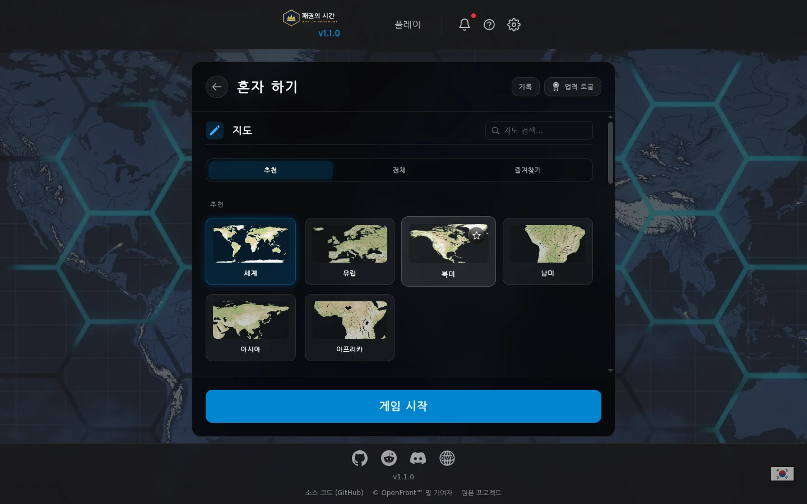
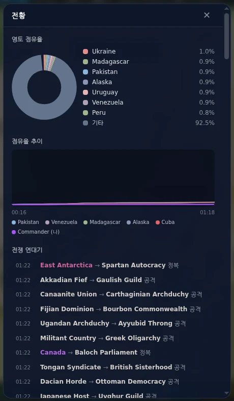
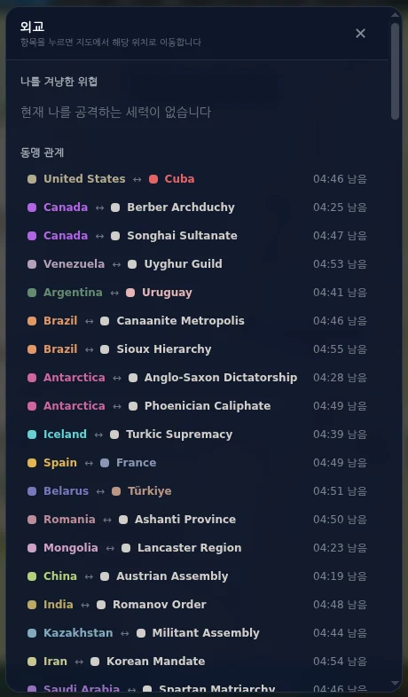
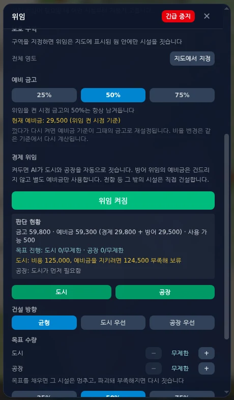
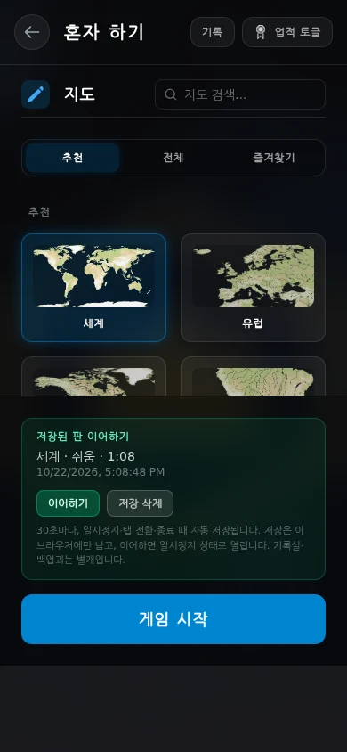
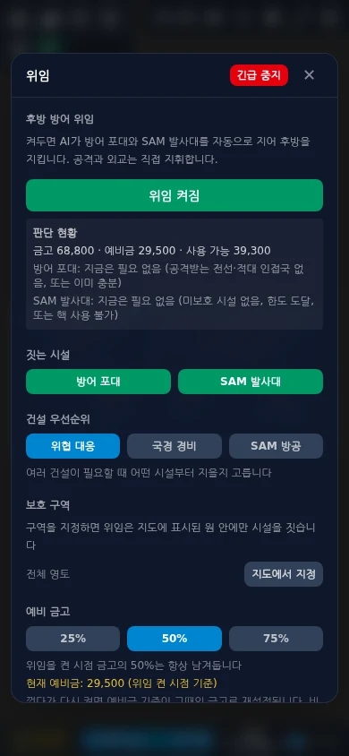

<div align="center">

# 패권의 시간
### Age of Hegemony

**확장하고, 동맹을 맺고, 전선을 지휘하세요.**  
OpenFrontIO를 바탕으로 만든 한국어 싱글플레이 전략 게임입니다.

[**지금 브라우저에서 플레이**](https://sigco3111.github.io/hegemony-war-pages/) · [플레이 가이드](#빠르게-시작하기) · [저장 안내](#저장과-백업) · [설계 문서](docs/DESIGN.md)

설치·로그인 없이 시작 · 135개 지도 · AI 국가 외교 · 선택적 건설 위임 · 중간 저장

</div>



> 이 프로젝트는 [OpenFrontIO](https://github.com/openfrontio/OpenFrontIO)의 **비공식 싱글플레이 개선 포크**입니다. 원작의 공식 서비스가 아니며, 멀티플레이·계정·온라인 순위·상점·사운드는 제공하지 않습니다.

## 어떤 게임인가요?

작은 영토에서 출발해 병력과 금고를 키우고, 주변 세력을 정복하며 패권을 겨룹니다. 무작정 공격하기보다 병력 비율, 국경의 위험, 경제 시설, 동맹의 남은 시간을 함께 살펴야 합니다.

**전투와 외교는 직접, 반복 건설은 선택적으로 위임**하는 방식입니다. 잠시 멈춰 공격 순서를 계획하고, 전황판으로 흐름을 읽으며, 같은 브라우저에서 저장된 판을 이어갈 수 있습니다.

- **한 판의 전략:** 영토 확장, 경제 성장, 방어 시설, 해상 진출과 외교를 조합합니다.
- **혼자 하는 도전:** 쉬움부터 불지옥까지 난이도와 여러 규칙을 고릅니다. 상대는 AI입니다.
- **쌓이는 성과:** 기기에 남는 전적, 지도별 정복 메달, 11개 챌린지로 다음 목표를 정합니다.

### 목차

- [빠르게 시작하기](#빠르게-시작하기)
- [조작법](#조작법)
- [주요 기능](#주요-기능)
- [저장과 백업](#저장과-백업)
- [알아둘 제한](#알아둘-제한)
- [개발과 빌드](#개발과-빌드)
- [라이선스와 크레딧](#라이선스와-크레딧)

## 빠르게 시작하기

1. **[플레이 페이지](https://sigco3111.github.io/hegemony-war-pages/)**를 열고 표시 이름을 정합니다. 계정 가입은 필요 없습니다.
2. **혼자 하기**에서 지도와 난이도를 고릅니다. 처음에는 추천 지도의 **쉬움**으로 시작해 조작에 익숙해져 보세요.
3. **게임 시작**을 누른 뒤 지도에서 시작 위치를 선택합니다.
4. 주변 땅을 눌러 확장합니다. 아래 **공격 비율 슬라이더**로 한 번에 보낼 병력의 비율을 조절합니다.
5. 왼쪽의 **전황·외교·위임·작전 계획** 버튼을 필요할 때 엽니다. 급하면 오른쪽 위 **일시정지**로 생각할 시간을 확보하세요.



*세계·유럽·아시아 같은 지리 지도와 특수 지도를 포함해 135개 지도를 수록했습니다. 전체·검색·즐겨찾기로 원하는 지도를 찾을 수 있습니다.*

### 첫 판을 위한 팁

- 병력을 한꺼번에 소모하면 다른 국가의 공격에 취약해집니다. 작은 비율로 확장하며 방어할 병력을 남겨두세요.
- 위임을 켰다고 즉시 시설이 생기는 것은 아닙니다. **판단 현황**에서 필요한 금, 예비금, 영토·도시 조건을 확인하세요.
- 강한 국가와의 동맹도 영구적이지 않습니다. 외교판의 남은 시간과 관계 변화를 확인하세요.
- 메달과 챌린지를 노린다면 **무한 금·무한 병력·즉시 건설**은 끄세요. 해당 옵션을 쓴 판은 전적에 남지만 보상은 인정되지 않습니다.

## 조작법

아래는 기본 키 설정입니다. 설정에서 조작 방식을 바꾸면 실제 동작도 달라집니다.

| 하고 싶은 일 | 기본 조작 |
| --- | --- |
| 시작 위치 선택 / 지상 확장·공격 | 지도 클릭 또는 터치 |
| 대상 행동 메뉴 열기 | PC에서 우클릭. 터치에서는 대상 메뉴 이용 |
| 지도 이동 | 드래그, `W A S D` 또는 방향키 |
| 확대·축소 | 마우스 휠, `Q` / `E`, `-` / `+` |
| 내 영토로 카메라 이동 | `C` |
| 공격 병력 비율 낮추기 / 높이기 | 아래 슬라이더 또는 `T` / `Y` |
| 일시정지 / 재개 | 오른쪽 위 버튼 또는 `P` |
| 배속 낮추기 / 높이기 | `,` / `.` |
| 도시 / 공장 / 항구 건설 | `1` / `2` / `3` |
| 방어 진지 / 미사일 발사대 / SAM 건설 | `4` / `5` / `6` |
| 군함 건설 | `7` |
| 보기 전환 | `Space` |

건설은 비용·해안·시설 간격·게임 규칙 등 배치 조건을 만족해야 합니다. 화면에 표시되는 시설 버튼과 대상 메뉴도 함께 사용할 수 있습니다.

## 주요 기능

### 1. 전황을 한눈에 읽기

**전황** 패널에서 국가별 영토 점유율, 점유율 추이, 전쟁 연대기를 봅니다. 누가 커지고 있는지, 어느 국가가 공격·정복·동맹 파기를 했는지 같은 화면에서 살필 수 있습니다.



*전쟁 연대기는 AI가 동맹을 맺거나 파기한 판단 이유도 보여줍니다.*

### 2. 외교와 지도 위 위협 표시

**외교** 패널은 나를 겨냥한 공격, 국가 간 동맹과 남은 시간, 국가별 관계를 모아 보여줍니다. 동맹 제안·파기를 실행하고, 항목을 눌러 지도에서 해당 위치로 이동할 수 있습니다.

AI도 세력 구도에 반응합니다. 압도적인 선두를 견제하기 위해 연합하거나, 불리한 동맹을 파기할 수 있습니다. 난이도와 동맹 허용 설정에 따라 행동이 달라집니다.



지도 외교 표시를 켜면 다음 정보를 지도에 겹쳐 봅니다.

- **녹색:** 내 동맹
- **적색:** 나를 공격 중인 세력과 침공 전선
- **황색:** 패권 위협 국가

> 지도 위 침공 표시는 병력 공격을 대상으로 합니다. 핵무기 경보를 대신하는 기능은 아닙니다.

### 3. 멈춰서 준비하는 작전 계획

일시정지 상태에서 공격을 예약하고, 목록에서 **병력 비율·순서·취소**를 정합니다. 지도에는 목록과 대응하는 번호 배지와 점선 경로가 표시됩니다.

- 재개하면 위에서부터 순서대로 발송합니다.
- 발송 시점의 남은 병력에 비율을 적용합니다.
- 대상 소멸, 동맹 전환, 병력 부족 등으로 무효가 된 작전은 이유를 표시하고 건너뜁니다.
- 목록의 작전을 누르면 해당 위치로 카메라가 이동합니다.

**예약 대기열은 중간 저장에 포함되지 않습니다.** 이어하기 후에는 작전을 다시 정해야 합니다.

### 4. 필요한 건설만 AI에 위임하기

**위임** 패널에서 방어와 경제를 따로 켜고 끕니다. 모든 행동을 맡기는 자동 플레이가 아니라, 지정한 시설의 건설을 돕는 기능입니다.

| 구분 | 자동으로 짓는 시설 | 직접 정하는 항목 |
| --- | --- | --- |
| 후방 방어 | 방어 포대, SAM 발사대 | 시설별 토글, 위협 대응·국경 경비·SAM 방공 우선순위, 보호 구역, 예비 금고 |
| 경제 | 도시, 공장 | 시설별 토글, 균형·도시 우선·공장 우선, 시설별 목표 수량, 예비 금고 |

- 경제 목표는 **무제한 또는 1~20개**입니다. 목표를 채운 시설은 멈추고, 파괴돼 부족해지면 조건을 만족할 때 재건합니다.
- 예비금은 **위임을 켠 시점 금고**를 기준으로 계산합니다. 끄고 다시 켜면 기준이 바뀝니다.
- 경제 위임은 자기 예비금과 활성 방어 위임의 예비금을 함께 보호합니다.
- **판단 현황**은 건설비·부족액·목표 진행과 보류 이유를 보여줍니다. **행동 기록**에는 시설·시간·비용이 남습니다.
- **공격·외교·전함 및 그 밖의 시설은 수동**입니다.



#### 긴급 중지

패널 위쪽의 빨간 **긴급 중지**는 방어·경제 위임을 한 번에 끕니다. 목표와 우선순위 설정은 남고, 다시 켜는 것은 직접 선택합니다. 게임 자체의 일시정지와는 별개입니다.

일시정지 중 바꾼 위임 설정과 긴급 중지는 저장되며, 재개 후 첫 턴에 엔진에 적용됩니다.

### 5. 기록실·메달·챌린지

**혼자 하기 → 기록**에서 총판·승리·승률·정복한 지도와 최근 전적을 확인합니다. 지도별 승리 난이도는 메달로 남습니다.

| 종류 | 내용 |
| --- | --- |
| 업적형 6개 | 한반도의 기상, 황해의 제왕, 동아시아의 패자, 포위 돌파, 핵전쟁 생존자, 불가능은 없다 |
| 시나리오형 4개 | 속전속결, 최후의 방어선, 비핵 시대, 압도적 열세 |
| 메타 1개 | 나머지 챌린지를 모두 달성하는 패권의 시간 |

시나리오의 **도전** 버튼은 특별 규칙의 판을 바로 준비합니다. 예를 들어 시간 제한, 핵무기 금지, 다수의 봇 같은 조건이 적용됩니다. 단순히 승리하는 것뿐 아니라 해당 규칙을 실제로 만족해야 합니다.

## 저장과 백업

**진행 중인 한 판**, **완료한 전적**, **설정**은 서로 다른 데이터입니다.

| 데이터 | 보관 방식 | 다른 기기로 옮기기 |
| --- | --- | --- |
| 중간 저장 | 같은 브라우저·사이트의 IndexedDB, 한 슬롯 | 기록실 백업에 포함되지 않음 |
| 전적·메달·챌린지 | 브라우저 localStorage | 기록실 JSON 내보내기 / 가져오기 |
| 조작·표시 등 설정 | 별도 브라우저 저장 | 기록실 백업에 포함되지 않음 |

### 중간 저장·이어하기

**혼자 하기** 아래에 **저장된 판 이어하기** 카드가 나타납니다. 이어하면 저장된 턴을 같은 엔진으로 재생해 복원하고, **일시정지 상태**로 엽니다.

- 자동 저장 시도: **300턴마다**(1배속 게임 시간 약 30초), 일시정지, 탭 숨김·전환, 페이지를 떠날 때
- 보관: 브라우저·사이트별 **한 판**. 새 판의 저장이 이전 슬롯을 덮어씁니다.
- 종료: 승패가 확정되면 해당 중간 저장을 지웁니다.
- 긴 판: 복원할 턴이 많으면 이어하는 데 시간이 걸릴 수 있습니다.



#### 저장은 즉시 완료되는 보장이 아닙니다

저장은 **비동기**입니다. 탭 닫기·강제 종료·배터리 방전 시에는 브라우저가 쓰기를 끝내지 못할 수 있습니다. 마지막 진행 구간이 유실될 수 있으며, **"최대 30초만 잃는다"는 보장은 없습니다.** 저장 공간·권한 문제로 쓰기가 실패하면 이전 저장이 남을 수 있습니다.

안전하게 끊으려면 **먼저 일시정지하고 잠시 기다린 뒤** 페이지를 닫으세요. 그래도 강제 종료까지 보장하는 저장 방식은 아닙니다.

#### 복원 범위

- 일시정지 상태로 저장한 판은 반복해서 이어도 엔진 시점·금고·병력·영토 값이 늘지 않습니다.
- **실행 중 자동 저장**에서 이어하면 엔진을 멈추기 위해 **일시정지 1틱**이 추가됩니다.
- **복원하지 않는 것:** 예약 작전 대기열, 카메라 위치, 선택 상태, 위임 행동 기록과 누적 지출 표시
- 엔진 저장 버전이 달라진 업데이트에서는 이전 판을 이어할 수 없습니다.
- 브라우저 데이터 삭제, 다른 브라우저·기기·사이트 주소 사용 시 기존 판을 찾을 수 없습니다. 계정 동기화는 없습니다.

### 전적 JSON 백업·복원

1. **혼자 하기 → 기록 → 내보내기**로 JSON 파일을 보관합니다.
2. 옮길 브라우저에서 **가져오기**로 파일을 선택합니다.
3. 가져오기는 기존 기록에 **합치는 방식**입니다. 같은 기록은 중복 추가하지 않습니다.

최근 판별 전적은 **최대 200건**입니다. 가져온 오래된 판이 이 한도를 넘으면 일부가 제외될 수 있습니다. 메달·챌린지·달성 증거는 최근 전적 목록과 별도로 보존합니다.

> 기록실 백업은 **전적용**입니다. 진행 중인 판이나 설정까지 복구하는 전체 백업이 아닙니다. 사이트 데이터를 지우기 전에는 전적을 따로 내보내세요.

## 알아둘 제한



*스크린샷은 2026-10-22 배포판을 별도의 테스트 판에서 촬영했습니다. 일부 패널 이미지는 읽기 쉽도록 실제 화면에서 잘랐습니다.*

- **PC 브라우저 권장:** 작은 화면에서는 패널을 스크롤하며 이용합니다. 390×844 세로 화면은 확인했지만 실제 iPhone Safari와 강제 종료 복원은 검증하지 않았습니다.
- **정적 싱글플레이:** 게임 서버 없이 동작합니다. 다만 처음 사이트와 지도·코드를 불러올 때는 인터넷이 필요합니다. 설치형 오프라인 앱이나 오프라인 재접속을 보장하지 않습니다.
- **선택적 위임:** 경제 목표 도달 후 중단은 실제 플레이에서 확인했습니다. 파괴 후 자동 재건은 단위 테스트로 검증했으며 실제 플레이 검증과는 구분합니다.
- **검증 범위:** 저장·위임 등 관련 테스트와 브라우저 점검을 진행했습니다. 전체 원작 테스트 모음 통과나 모든 기기 지원을 뜻하지 않습니다.
- **이전 기록 관련:** 과거 배포의 챌린지 정정 문제로 사라진 업적은 당시 전적이나 백업이 남아 있지 않으면 복구하지 못할 수 있습니다.

## 개발과 빌드

### 기술 구성

- **TypeScript + Lit:** 메뉴와 HUD 패널
- **Canvas / WebGL:** 지도와 게임 화면
- **로컬 엔진 / Worker:** 싱글플레이 시뮬레이션
- **Vite:** 개발 서버와 정적 빌드
- **Vitest:** 기록·챌린지·외교·작전·위임·저장 로직 테스트
- **localStorage / IndexedDB:** 전적·설정 / 중간 저장

### 로컬 실행

`package.json`의 요구 환경은 **Node.js 24.15 이상 25 미만, npm 12.1 이상 13 미만**입니다.

```bash
git clone https://github.com/sigco3111/hegemony-war.git
cd hegemony-war
npm ci --ignore-scripts

# 서버 의존 UI를 끈 싱글 전용 개발 모드
PAGES_BASE=/ CDN_BASE= GAME_ENV=dev DOMAIN=localhost npm run start:client
```

개발 서버의 기본 포트는 `9000`입니다. `PAGES_BASE`가 싱글 전용 정적 모드의 스위치이므로 빼지 마세요. 원작용 서버·멀티플레이 스크립트도 저장소에 남아 있지만, 이 배포판에는 필요하지 않습니다.

### 정적 빌드

현재 공개 사이트와 같은 서브경로로 빌드하는 명령입니다.

```bash
PAGES_BASE=/hegemony-war-pages/ \
CDN_BASE=/hegemony-war-pages \
GAME_ENV=prod \
DOMAIN=sigco3111.github.io \
npx vite build --mode static
```

출력 디렉터리는 `static/`입니다. 다른 경로에 배포할 때는 `PAGES_BASE`와 `CDN_BASE`를 배포 주소에 맞춥니다.

### 테스트

```bash
# 이번 포크의 주요 저장·위임·작전·백업 로직
npx vitest run tests/SaveGame.test.ts tests/DefenseDelegation.test.ts \
  tests/EconomyDelegation.test.ts tests/WarPlan.test.ts tests/RecordsBackup.test.ts

# 전체 테스트 모음 실행
npm test
```

위 명령은 실행 방법을 안내하는 것이며, 전체 테스트 성공을 보증하는 표기가 아닙니다.

### 소스 안내

| 위치 | 역할 |
| --- | --- |
| `src/client/hud/layers/` | 전황·외교·위임·작전 패널과 지도 표시 |
| `src/client/LocalRecords.ts`, `Challenges.ts`, `RecordsBackup.ts` | 기기 전적·도전·백업 |
| `src/client/SaveGame.ts`, `WarPlan.ts` | 중간 저장과 작전 큐 |
| `packages/engine/` | 게임 시뮬레이션과 AI·건설 위임 |
| `packages/engine-api/` | 엔진 타입·스키마·지도 목록 |
| `resources/` | 지도·언어·이미지 등 공개 에셋 |
| `tests/` | 단위·통합 테스트 |
| [`docs/DESIGN.md`](docs/DESIGN.md) | 개선 배경·구현·검증과 한계 |

### 저장소와 배포

- **[hegemony-war](https://github.com/sigco3111/hegemony-war):** 게임 소스와 문서. 현재 `*payload.zip` 변경은 `apply-payload` 작업이 main에 적용합니다.
- **[hegemony-war-pages](https://github.com/sigco3111/hegemony-war-pages):** 소스를 체크아웃하고 빌드해 GitHub Pages에 올리는 배포 전용 저장소입니다.
- 한국어 안내는 이 README를 기준으로 하며, 원본 영문 README는 [`README.en.md`](README.en.md)에 보존했습니다.

## 라이선스와 크레딧

**© OpenFront and Contributors**

이 게임은 [OpenFrontIO](https://github.com/openfrontio/OpenFrontIO)의 코드와 공개 에셋을 바탕으로 수정했습니다. 원작과 기여자에게 감사드립니다. 이 포크의 이름과 변경 사항이 원작의 공식 승인이나 제휴를 뜻하지는 않습니다.

- **코드:** [GNU AGPL v3.0](LICENSE). 추가 저작자 표시 조건을 포함한 원작 고지를 유지합니다.
- **공개 에셋:** `resources/`는 [CC BY-SA 4.0](https://creativecommons.org/licenses/by-sa/4.0/) 대상입니다. 출처 표시는 OpenFront / OpenFront Inc.입니다.
- **제외 사항:** 비공개·외부 에셋과 `proprietary/`는 공개 에셋과 같은 허용 범위가 아닙니다. 상세 조건은 [`LICENSE-ASSETS`](LICENSE-ASSETS)와 [`LICENSING.md`](LICENSING.md)를 확인하세요.
- **스크린샷:** 이 포크의 실제 플레이 화면이며 OpenFront 기반 지도·UI를 포함합니다. 원본 사진이나 생성 이미지로 대체하지 않았습니다.
